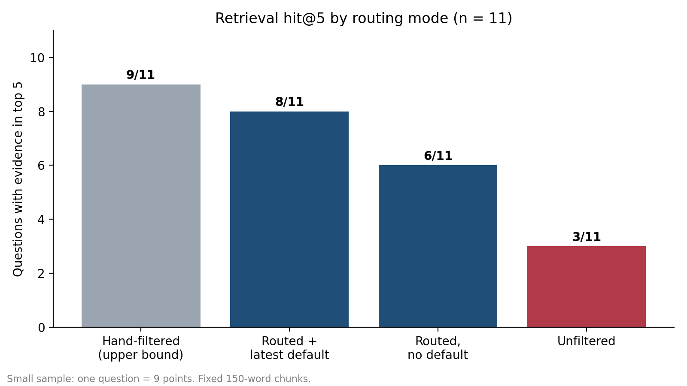
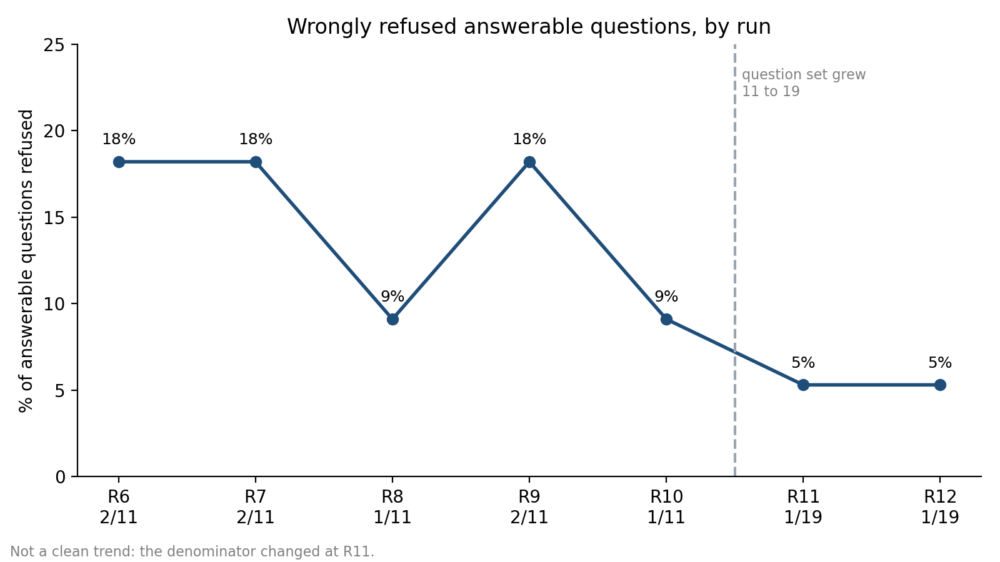
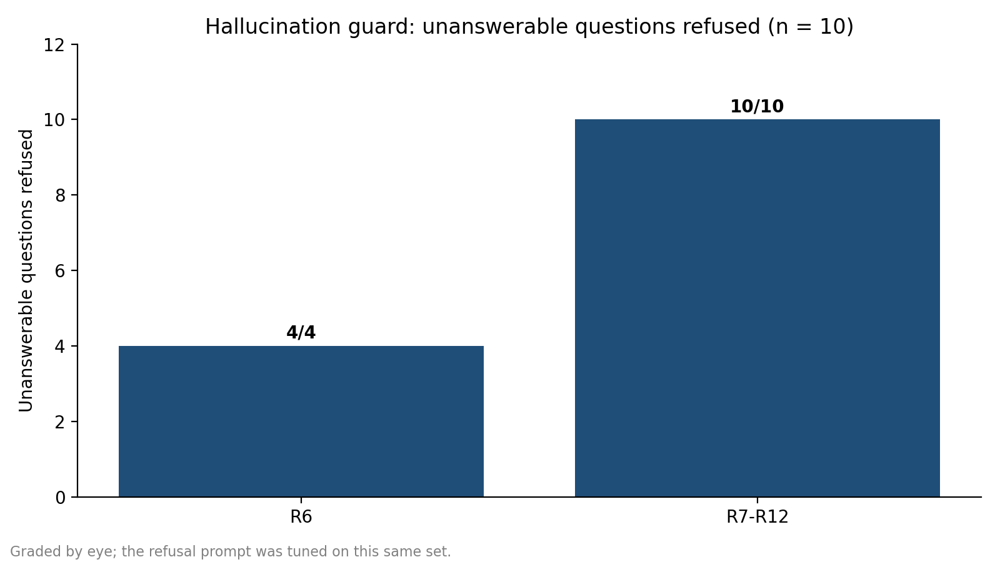

# SEC Filings RAG Assistant

## Business problem

Analysts spend hours locating and cross-checking answers in 10-K filings. This tool returns answers with citations to filing, section and passage, and refuses when the filings do not support an answer.

## Scope

Companies: MSFT, ORCL, CRM, ADBE, NOW, INTU, WDAY, PANW

Filings: 10-K, last 3 fiscal years

## Results

Evaluation set: 29 questions written from the filing text before reading model output (11 early answerable, 8 fresh answerable, 10 unanswerable).

- Unanswerable questions refused: 10 of 10
- Answerable questions wrongly refused: 1 of 19 (a cross-year question)
- Failed model calls in final run: 0

Retrieval findings:

- Retrieval hit@5 on the 11 early answerable questions (fixed chunks): hand-filtered 9, company routing with latest-filing default 8, routing without the default 6, no filter 3. On the 7 single-filing questions alone, removing the filter dropped hit@5 from 7/7 to 2/7. Most questions target the newest filing, so the latest-filing default favors this test set.
- A distance cutoff cannot decide refusal: distances for unanswerable and answerable questions overlap fully, so refusal comes from the answer prompt.
- Table percentages were missing from retrieved chunks because my cleaning step deleted short numeric lines. Fixing that, then adding figure-density keyword matching, made the Adobe revenue-growth question answer correctly.

Limitations:

- Small sample: 10 unanswerable questions is a direction, not a rate.
- Answer correctness was judged by eye against my gold answers, with no second rater.
- The figure-density scoring was adjusted after seeing one failing question, so it is tuned on part of this set. The 8 fresh questions were chosen from clean prose facts, so they are easier than average.
- The model is gemini-3.1-flash-lite (a fixed name). Earlier runs used the gemini-flash-lite-latest alias.
- Cross-year questions are the weakest area: q14 is still wrongly refused.

Full run history: eval/results_log.md

## Tools

Python, requests, BeautifulSoup, sentence-transformers (all-MiniLM-L6-v2), ChromaDB, Gemini API

## How to run

1. Install: pip install -r requirements.txt
2. Create a file named .env containing GEMINI_API_KEY=your_key
3. Build the data: python src\ingest.py, then python src\parse_sections.py, then python src\index.py
4. Ask a question: python src\answer.py your question here
5. Run the evaluation: python eval\run_answers.py

